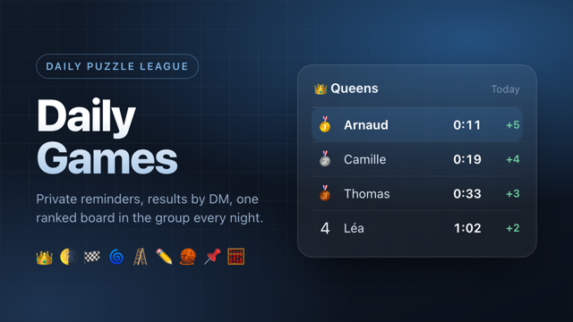

# Daily Games

A Telegram bot for a group of friends who play daily puzzle games. It reminds
each player privately, collects their results, and posts one ranked leaderboard
to the group every night.



The two problems it solves are equal: **forgetting to play**, and **scores
having no home**. Before it, the group played whatever they remembered and
pasted share text into a chat, where it scrolled away untallied.

Runs entirely on the Cloudflare free tier — one Worker holds the bot webhook,
the cron, the API and the Mini App.

Want to build your own? See [RECIPE.md](RECIPE.md).

---

## How it works

1. **Sign up** — tap the link the bot posts when it joins your group. That one
   tap starts the DM, selects every game, sets a 09:00 reminder and adds you to
   that group's leaderboard.
2. **Play** — the bot DMs you at your chosen hour with links to your games.
3. **Paste your results** — in the DM, or straight into the group. Either
   works, and one message can hold a whole day's games.
4. **Read the board** — posted to the group once every member has a score for
   every game they selected, or at 21:00 Paris, whichever comes first. Tap
   through to the Mini App for today / this week / all time.

### LinkedIn: nobody pastes anything

The eight LinkedIn games import themselves. One player (the captain) is a
LinkedIn connection of everyone in the group, and LinkedIn shows a
connection's result for every game they finished. So every ten minutes the
cron reads the captain's connections leaderboards through LinkedIn's internal
API ("Voyager", the one linkedin.com itself uses) and stores each ranked row
under the matching player. Pasting the same result later just rewrites the
same row; Wordle and the rest still go through paste or the Shortcut.

#### Setting the tokens

The captain's two linkedin.com cookies, stored as Worker secrets. Once a
year, or whenever the captain gets the "LinkedIn import stopped" DM.

1. Log in to linkedin.com in Chrome, open DevTools (⌥⌘I).
2. `JSESSIONID` is readable from the **Console**:
   ```js
   copy(document.cookie.match(/JSESSIONID="?([^";]+)/)[1])
   ```
   It looks like `ajax:7386723986815546105`.
3. `li_at` is httpOnly, so no script can read it: **Application** tab →
   **Cookies** → `https://www.linkedin.com` → filter `li_at` → double-click
   the Value, copy. It starts with `AQE`.
4. Store both. Each command prompts for the value (paste, Enter):
   ```
   pnpm exec wrangler secret put LI_JSESSIONID
   pnpm exec wrangler secret put LI_AT
   ```
   Secrets take effect on the next cron tick; no redeploy needed.
5. Check: `wrangler d1 execute daily-games --remote --command "SELECT COUNT(*) FROM linkedin_profiles"`
   is non-zero within ten minutes.

Without the secrets the import is a no-op. When the session lapses (401, 403,
999 or a redirect to login), the captain gets one DM a day asking for a
re-paste. Signing out of LinkedIn on that browser kills `li_at`, so stay
signed in there. Never commit the values.

Mapping LinkedIn profiles to players. The captain's leaderboard is mostly
people who are not in the group, so nothing is guessed from names:

- **Self-service** — `/linkedin https://www.linkedin.com/in/<you>` in the DM.
  If that profile has already shown up on the leaderboard it links at once;
  otherwise the slug is kept and links itself the first time it appears
  (which needs them to be a connection of the captain). `/linkedin off`
  unlinks or cancels. Anyone who pastes a LinkedIn result by hand while
  unlinked gets this suggested in the ack.
- **Operator** — `GET /admin/linkedin` lists unmapped profiles;
  `POST /admin/linkedin/link` with `{"profileUrn","userId"}` maps a seen
  profile, `{"publicIdentifier","userId"}` pre-feeds a slug.

Connections who opted out of LinkedIn's leaderboard appear without a rank and
get nothing imported. The two Voyager queries were lifted from the games hub's
own traffic (`test/fixtures/voyager/`); their `queryId` hashes can rotate on a
LinkedIn deploy, in which case the import silently returns nothing until the
ids in `src/lib/voyager.ts` are refreshed.

### iPhone: submit from the share sheet

Copying eight share texts into Telegram every day is the chore this removes.
Send `/shortcut` to the bot: it replies with a link to a signed Shortcut and a
personal URL. Install the Shortcut, paste the URL when asked, and from then on
every game is **Share → Share via → Daily Games**. The result is logged over
HTTP, acknowledged in a notification and mirrored in your DM.

The URL is the credential. `/shortcut` again rotates it and kills the old one.
The Shortcut itself is built from a plist and signed with the macOS `shortcuts`
CLI (`shortcuts sign --mode anyone`); it lives in `web/public/`.

### Games

| Game | Offerable | Id | Link |
|---|---|---|---|
| 👑 Queens | yes | `queens` | https://lnkd.in/queens |
| 🌗 Tango | yes | `tango` | https://lnkd.in/tango |
| 🏁 Zip | yes | `zip` | https://lnkd.in/zip |
| 🌀 Wend | yes | `wend` | https://lnkd.in/wend |
| 🪜 Crossclimb | yes | `crossclimb` | https://lnkd.in/crossclimb |
| ✏️ Mini Sudoku | yes | `minisudoku` | https://lnkd.in/minisudoku |
| 🧶 Patches | yes | `patches` | https://lnkd.in/patches |
| 📌 Pinpoint | yes | `pinpoint` | https://lnkd.in/pinpoint |
| 🟩 Wordle | yes | `wordle` | https://www.nytimes.com/games/wordle/ |
| 🇫🇷 Le Mot | yes | `lemot` | https://wordle.louan.me/ |
| 🧇 Waffle | yes | `waffle` | https://wafflegame.net/ |
| 🧮 Fermi | yes | `fermi` | https://fermi.gg/ |
| 🌍 Geozee | yes | `geozee` | https://geozee.earth/ |
| 🔢 Tupo | yes | `tupo` | https://playtupo.com/ |
| 📗 Table des Savoirs · Abordable | yes | `lts_abordable` | https://latabledessavoirs.fr/abordable |
| 📕 Table des Savoirs · Expert | yes | `lts_expert` | https://latabledessavoirs.fr/difficile |

Every parser is verified against real pasted share text, kept verbatim in
`test/unit/real-samples.test.ts`. If a case there fails, the parser is wrong,
not the fixture. Adding a game is a code change on purpose: a game with no
working parser would let people submit all week and score nothing.

---

## Scoring

**Step 1 — every game becomes one number, where lower is better.**

| Game | Raw | Stored |
|---|---|---|
| Queens, Zip, Tango… | `0:11` | `11` (seconds) |
| Pinpoint | `2 guesses` | `2`, or `6` when no guess lands |
| Fermi | `1.72×` | `1.72` (1.00 is perfect) |
| Table des Savoirs, Geozee | `240 points`, `257/742` | `-240`, `-257` (negated — more is better) |
| Wordle, Le Mot | `X/6` | `7` (sorts below every success) |

These numbers never reach a leaderboard. They exist only to sort one game, on
one day, within one group — which is why Fermi and Queens coexist without
comparing multipliers to seconds.

**Step 2 — rank each game each day, then convert rank to points.**

```
field size: 5
  rank 1  Alice   0:11  +5
  rank 2  Bob     0:19  +4
  rank 2  Chloe   0:19  +4      tie shares the better rank
  rank 4  Thomas  0:33  +2      and the next rank skips
  absent: Lea                   listed, scores nothing
```

`points = field − rank + 1`, where **field is everyone who *selected* that
game** — played or not. That is the load-bearing choice. It means a day when
one person shows up is worth exactly as much as a busy one:

```
quiet day, Alice alone and slower:
  rank 1  Alice   0:45  +5
```

Otherwise turning up on a quiet day would *cost* points, which is backwards for
a game about daily habit.

**Step 3 — two aggregates, because they reward different things.**

- **Total** rewards turning up. It is the headline number.
- **Average per game** rewards being good, and needs a floor or one lucky first
  place is unbeatable: you must have played **60% of the days since you joined
  that group** to appear.

The denominator is *since you joined*, not the whole period, so a newcomer is
not punished for days they could not have played.

Standings are a property of the group, not the player. One score feeds every
group you are in, ranked against a different field each time.

---

## Setup

```bash
pnpm install
pnpm exec wrangler login   # interactive, opens a browser
pnpm bootstrap             # everything else
```

`pnpm bootstrap` is safe to re-run. It checks your Cloudflare login, validates
the bot token against `getMe`, creates the D1 database and writes its id into
`wrangler.jsonc`, applies the schema, generates and stores `WEBHOOK_SECRET`,
builds the Mini App, deploys, and registers the webhook with `allowed_updates`
scoped to what the bot actually handles.

> Named `bootstrap`, not `setup`: `pnpm setup` is a built-in pnpm command that
> configures pnpm itself and edits your shell profile, and built-ins shadow
> scripts. Same reason the deploy script is invoked as `pnpm run deploy`.

Three things only BotFather can do:

1. **`/newapp`** → point at the Workers URL → copy the **short name** into
   `MINIAPP_SHORT_NAME` in `wrangler.jsonc`, then `pnpm run deploy`. Use
   `assets/miniapp-cover.png` for the required 640×360 image.
2. **`/setuserpic`** → upload `assets/bot-icon.png`.
3. **`/setprivacy` → Disable**, then **remove and re-add the bot to each
   group**. Without this the bot cannot see results pasted in the group; the
   re-add is required because the setting does not apply retroactively.

`MINIAPP_SHORT_NAME` and `BOT_USERNAME` have no defaults on purpose. An
unregistered short name produces a `t.me` link that silently resolves to
nothing, and every group invite link is built from the username — a wrong value
posts links that look right and open nothing, so the Worker refuses to start
without it.

### Doing it by hand

```bash
pnpm exec wrangler d1 create daily-games      # paste database_id into wrangler.jsonc
pnpm db:remote                                 # schema
pnpm exec wrangler secret put BOT_TOKEN
pnpm exec wrangler secret put WEBHOOK_SECRET
pnpm run deploy                                # note the workers.dev URL
curl "https://api.telegram.org/bot<TOKEN>/setWebhook" \
  -d "url=https://<worker>/telegram/webhook" \
  -d "secret_token=<WEBHOOK_SECRET>"
```

---

## Operations

All admin endpoints take `X-Admin-Secret: <WEBHOOK_SECRET>`.

| Endpoint | Why it exists |
|---|---|
| `POST /admin/run-cron` | Cron fires every 15 minutes, a painfully slow loop when something is wrong |
| `POST /admin/replay` | Re-scores logged messages a since-fixed parser can now read |
| `POST /api/ingest/<token>` | Not admin: the iPhone Shortcut posts share text here, the token minted by `/shortcut` is the auth |
| `POST /admin/offer-game?game=<id>` | `player_games` is seeded at signup, so a game added later reaches nobody who already joined |

**Calibration.** Every message that looks like a result is stored whether or not
it parsed:

```sql
SELECT text FROM messages WHERE matched_games IS NULL ORDER BY sent_at DESC;
```

Write a regex against the real samples, ship it, then `POST /admin/replay` to
recover the days it missed — `scores.raw` keeps the original message.

**Is the scheduler alive?**

```sql
SELECT source, count(*), datetime(max(ran_at),'unixepoch') FROM cron_runs GROUP BY source;
```

A tick that finds no work is otherwise indistinguishable from one that never
ran. Note that changing a cron trigger takes up to 15 minutes to propagate, so
a tick shortly after a deploy proves nothing.

**Fake players for testing:**

```bash
TEST_CHAT=-100123 SEED_FROM_USER=456 bash scripts/seed-test-players.sh
bash scripts/seed-test-players.sh --undo
```

Three players with scores shaped to exercise ties and absences. They are
inserted `active = 0`: never DM'd, never blocking the digest, but still ranked
and still counted in the field.

---

## Development

```bash
pnpm test           # unit (pure, fast) + worker (workerd + real D1)
pnpm typecheck      # Worker and Mini App
pnpm images         # regenerate the BotFather PNGs from their HTML sources
pnpm run deploy
```

```
src/
  index.ts        routing only
  api/            leaderboard (initData auth) + admin endpoints
  bot/            onboarding, groups, DM and group ingestion
  db/             one module per table group
  games/          one parser per game, plus the registry
  lib/            time, ranking, digest, initData, deep links
  cron/           reminders and digest
web/              Vite + React Mini App, Telegram theme variables only
```

`lib/time.ts`, `lib/ranking.ts`, `lib/initdata.ts` and `games/*` are pure
functions with no D1 — that is where most of the tests live.

Dev is a second BotFather bot on its own Worker rather than a tunnel, since
webhooks need a public URL:

```bash
cp .dev.vars.example .dev.vars
pnpm exec wrangler deploy --env dev
```

---

## Design notes

Moved to [RECIPE.md](RECIPE.md#5-design-decisions-and-gotchas), with the
architecture and a build-your-own walkthrough.

---

## Licence

MIT — see [LICENSE](LICENSE).
